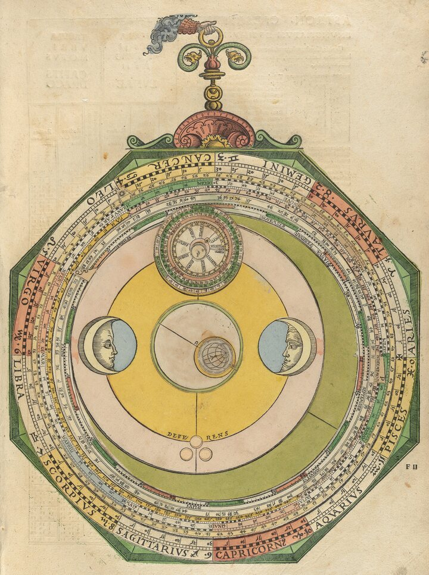
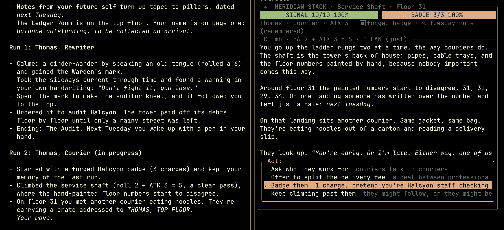

<p align="center">
  
</p>

<h1 align="center">volvelle</h1>

A combinatorial terminal UI for agents. An agent composes an interface from a
fixed catalog of atoms; a ratatui viewer renders it in a herdr pane beside the
agent and returns the human's answer as typed JSON.

A volvelle is a paper wheel of rotating discs, used from Llull to Kircher to
generate new combinations from fixed tables. Volvelle does the same with
interfaces. The one above, from Peter Apian's *Astronomicum Caesareum* (1540),
works out the moon's position and phase. The scan is public domain, from
Houghton Library, Harvard University (Typ 520.40.150), via
[Wikimedia Commons](https://commons.wikimedia.org/wiki/File:Houghton_Typ_520.40.150_-_Astronomicum_Caesareum,_1540_-_f2r.jpg).



*A tabletop RPG run by Claude Code. The run log is on the left; on the right,
volvelle shows the scene with signal and badge gauges, the last roll, and a
selectable list of actions whose answer goes back to the agent.*

<p align="center">
  
</p>

*A form answered in the viewer. Once it is sent the view locks until the
agent renders again.*

## Status

Phase 1 of the architecture: one agent, one view.

- `volvelle-schema`: the atom catalog and patterns as serde types, JSON
  Schema via schemars, validation rules with path-level errors, and the
  result schema each spec answers with.
- `volvelle`: the viewer. `volvelle view --socket PATH [--project DIR]`
  serves specs over a Unix socket; `volvelle show spec.json` renders one
  file (with `--data` for its binds) and prints the answer; `volvelle schema` prints the catalog schema.
- `volvelle-mcp`: stdio MCP server with `render`, `update`, `wait_event`,
  `close`, `library` and `save`. It splits a herdr pane for the viewer on first render.

Not yet built: replay from the event log, the shared-state server,
leases and CRDT regions (phases 2 to 4). See `docs/ROADMAP.md`, and
the [Linear project](https://linear.app/abstractmachines/project/volvelle-0395f8b06985)
for issues.

## Install

```sh
cargo build --release
claude mcp add volvelle -- "$PWD/target/release/volvelle-mcp"
```

`volvelle-mcp` looks for the `volvelle` binary next to itself, then on `PATH`.
Override with `VOLVELLE_BIN`.

While developing, `scripts/install-dev.sh` installs both binaries from the
checkout into `~/.cargo/bin` and points the MCP server at them. Run `/mcp` in
Claude Code afterwards to reconnect, since a running server keeps the old
binary.

## Protocol

Each view follows one session type, checked at runtime by `volvelle-mcp`:

```text
View = !Render . (!Render | !Update)* . ?Event . end
```

Render a view, re-render it or `update` its data as often as needed (the
user's input survives for ids that still exist), then wait for its one answer.
A display-only view takes updates until it is replaced or closed. A call out of order is
refused with the moves allowed next, for example:

```text
view "deploy" was already answered with {...}; allowed next: render
```

`render` returns the JSON Schema of the answer, and `wait_event` returns
exactly that shape:

```json
{"type": "submit", "view": "deploy", "button": "go",
 "values": {"env": "prod", "migrate": true, "note": "fix login"}}
```

Other answers are `select` (Enter on a list, tree, graph or state machine with an id), `cancel` (Esc) and
`answer` (a pattern's typed value, see below). A view with no fields or
buttons is display-only and cannot be waited on.

A pattern extends its view's session type. `confirm-destructive@1` is

```text
!Spec . ?{confirm: !Outcome . end, cancel: end}
```

so after `{"confirmed": true}` the agent owes the user an outcome: the only
move allowed is to render the same view again with what happened.
`wait_event` says so in a `next` hint, and anything else is refused:

```text
view "delete" was confirmed; report the outcome by rendering view "delete"; allowed next: render view "delete"
```

Specs that break a rule are refused with the path, the rule and what would
be accepted instead:

```text
at /children/1: confirm-destructive@1 must be the only interactive element in its view, but the view also has "force" at /children/2; allowed: render the other fields in an earlier view, a toggle plus a button instead of the pattern
```

## Atoms

| Atom | Holds | `bind` reads |
| --- | --- | --- |
| `box` | `children`, in a row or column, with an optional border and title | |
| `text` | `text`, with `tone`, `bold` and `align` | a string |
| `markdown` | `text` | a string |
| `table` | `headers`, `rows`, optional `widths` | an array of rows of strings |
| `list` | `items`; selectable with an `id` | an array of strings or `{label, value?, detail?}` |
| `tree` | nested `nodes`; selectable with an `id` | |
| `graph` | `nodes` and `edges`, `direction`, a highlighted `current` node; selectable with an `id` | the `current` node's id |
| `input` | `value`, `label`, `placeholder`, `secret`, `multiline` | a string, written back |
| `select` | `options`, `value`, `multi` | a single select's chosen value, written back |
| `toggle` | `value` and `label` | a boolean, written back |
| `button` | `label` and `tone`; submits every field | |
| `progress` | `value` from 0.0 to 1.0, `label`, `tone` | a number from 0.0 to 1.0 |
| `divider` | an optional `title` | |

See `examples/deploy.json` and `volvelle schema`. Atoms state intent: the
viewer owns sizing, focus order and colour. Ids may not contain `:`, which
names a pattern's parts.

## Data binding

An atom can read its content from a data document instead of holding it.
`bind` is a JSON Pointer into the `data` that `render` takes alongside the
spec, and it replaces the literal: an atom has one or the other, never both.
The spec becomes a template, and a saved template plus `data` is the cheap
way to draw a view again.

```json
{"view": "sheet", "saved": "sheet", "data": {"hero": {"name": "Ada", "hp": 0.75}}}
```

Every bind must resolve in `data` to the type its atom needs, and a spec with
binds and no `data` is refused. Errors name the bind and what exists nearby:

```text
at /children/0/bind: bind "/hero/hpp" does not resolve in data; allowed: "/hero/hp", "/hero/name"
```

`update` changes the data in place with the replace, add and remove subset
of JSON Patch. `-` as the last token of an `add` appends to an array. The
patch is applied all or nothing, and one that fails or leaves a bind unfit is
refused whole:

```json
{"view": "sheet", "patch": [{"op": "replace", "path": "/hero/hp", "value": 0.5},
                            {"op": "add", "path": "/inventory/-", "value": "rope"}]}
```

The viewer redraws what the patch reaches and keeps focus, scroll and the
user's input. A bound field the user has edited keeps their value, and the
reply lists its pointer: `{"kept": ["/hero/name"], "next": "update, wait_event"}`.
`update` is allowed wherever a re-render is, and is not an answer. When it
changes the answer's type, such as a bound list's items, the reply carries
the new `returns`.

Inputs, toggles and single selects write the user's input back. On submit
or select, `wait_event` returns `data` with each bound field's value at its
pointer, so the answer and the state are one document; on cancel it returns
`data` as it was. Multi selects do not bind. Ctrl-S saves the template
without its data. See `examples/bound-sheet.json` with
`examples/bound-sheet.data.json`:

```sh
volvelle show examples/bound-sheet.json --data examples/bound-sheet.data.json
```

<p align="center">
  
</p>

## Patterns

A pattern is a named, versioned composition with slots, a typed answer and
its own session type. It goes wherever an atom does, written as
`{"type": "pattern", "name": "<name>@<version>", ...slots}`. Slots are plain
data, so patterns never nest, and a view holds at most one, not counting
state machines, which answer like the graph they draw. Each pattern is
declared once in `volvelle-schema`; the `render` tool description and the
session monitor are generated from that declaration.

| Pattern | Slots | Answer `value` |
| --- | --- | --- |
| `confirm-destructive@1` | `id`, `summary` (Markdown), `consequence`, `title?`, `confirm_label?`, `cancel_label?`, `require_typing?` | `{"confirmed": bool}` |
| `choose-with-preview@1` | `id`, `items` (`label`, `preview` in Markdown, `value?`, `detail?`), `title?`, `multi?` | `{"selected": value}`, or an array with `multi` |
| `state-machine@1` | `states` (`id`, `label?`, `tone?`), `start`, `end?`, `transitions` (`from`, `to`, `label?`), `current?` or `bind?`, `id?`, `title?`, `direction?` | none; with `id`, a `select` whose value is a state id |

`confirm-destructive@1` enforces the safe defaults: focus starts on Cancel,
Confirm is drawn in the error tone, and with `require_typing` it stays
disabled until the user types that text exactly. It must be the only
interactive element in its view. `choose-with-preview@1` shows the preview of
the item under the cursor without a round trip to the agent. See
`examples/confirm.json` and `examples/choose.json`.

`state-machine@1` draws a state diagram on the `graph` atom. The agent names
the states, the `start` state, any `end` states and the labelled
transitions, and the viewer lays them out: a small `●` entry point leads to
`start`, end states carry a `◉` after their label, and `current` is lit in
the accent colour. Transitions between the same two states share one edge,
their labels joined with commas. Bind `current` instead and `update` moves the light, as
with a graph:

```json
{"type": "pattern", "name": "state-machine@1", "title": "Deploy",
 "states": [{"id": "build"}, {"id": "verify"}, {"id": "live", "tone": "success"},
            {"id": "rolled-back", "tone": "error"}],
 "start": "build", "end": ["live", "rolled-back"],
 "transitions": [{"from": "build", "to": "verify", "label": "artifact"},
                 {"from": "verify", "to": "live", "label": "green"},
                 {"from": "verify", "to": "rolled-back", "label": "red"}],
 "bind": "/state"}
```

There must be at least one state and at most 64, with unique ids, and at
most 256 transitions. `start`, every `end`, both ends of every transition,
`current` and the bound value must name a state. Every state must be
reachable from `start`, since one that is not is almost always a slip in the
spec, and end states have no outgoing transitions. Without an `id` the
pattern is display-only. With one, arrows move a focus marker over the
states and Enter answers `{"type": "select", "id": <id>, "value": <state
id>}`; the entry point is never focused, lit or answered. It owes nothing
after its answer. `examples/session-types.json` draws volvelle's own view
lifecycle and the `confirm-destructive@1` protocol this way.

<p align="center">
  
</p>

A `tree` holds nested `nodes`, each with a `label`, optional `detail` and
`children`, and `open: false` to start folded. A node's value defaults to its
path of labels joined with `/`, such as `src/app/main.rs`, and values must be
unique. With an `id` the tree is selectable and Enter answers `select` with
the node's value; without one it is display-only. With `leaves_only: true`
only nodes without children answer, and Enter on a node with children folds
or unfolds it. See `examples/tree.json`.

<p align="center">
  
</p>

A `graph` holds `nodes`, each an `id` with an optional `label` (the id by
default) and `tone`, and `edges`, each `from` and `to` a node id with an
optional `label`. The agent never places anything: the viewer lays the graph
out in layers, `down` by default or `right`, and draws it with box-drawing
lines and arrowheads. Edges that close a cycle run back up the side, a
self-loop is a `↺` marker beside its node, and edge labels sit beside their
edge. Node ids must be unique and every edge must name existing nodes;
self-loops and parallel edges are fine. A graph holds at most 64 nodes and
256 edges, which suits state machines and small dependency graphs. `current`
names a node to highlight in the accent colour, and binding it instead makes
`update` move the highlight:

```json
{"view": "deploy", "patch": [{"op": "replace", "path": "/state", "value": "verify"}]}
```

A graph larger than its pane shrinks like a selectable list and pans to
follow the focus marker. With an `id` the graph is selectable and Enter
answers `select` with the node's id; without one it is display-only. See
`examples/graph.json`, volvelle's own view lifecycle, and
`examples/deps.json`.

<p align="center">
  
</p>

## Saved views

The human decides first which views are worth keeping. Ctrl-S on any view,
answered or not, opens a prompt in the status line:

```text
 save as: sheet  [project|user] · tab scope · enter save · esc cancel
```

Tab switches the library, Enter saves, Esc closes the prompt, and keys typed
there never reach the view. Names are lowercase letters, digits and hyphens
(`[a-z0-9][a-z0-9-]{0,63}`). Saving over an existing name asks
`overwrite "sheet"? y/n` first. What is saved is the spec as the agent
rendered it, not what the user typed into its fields, and a bound spec is
saved without its data.

There are two libraries, one JSON file per view:

- Project: `.volvelle/library/<name>.json` in the directory `volvelle-mcp`
  runs in, which Claude Code sets to the project. It can be committed.
  The viewer offers it only when started with `--project`, which
  `volvelle-mcp` passes.
- User: `$VOLVELLE_USER_LIBRARY`, else `$XDG_DATA_HOME/volvelle/library`,
  else `~/.local/share/volvelle/library`.

A project entry shadows a user entry with the same name. Each file holds
`name`, `spec`, `saved_at_ms`, `origin` (`view`, the viewer's herdr `pane`,
and `by`, `user` or `agent`) and a one-line `summary`, such as
`Character sheet · 3 inputs, 2 buttons, 1 tree`.

The agent sees saved views through the `library` tool: with no arguments it
lists `name`, `scope`, `summary`, `saved_at_ms`, `origin_view` and `by`; with
`name` it returns the whole entry, `spec` included, to adapt. `render` takes
exactly one of `spec` or `saved`:

```json
{"view": "sheet", "saved": "sheet"}
```

A saved spec is validated like any other, so one whose pattern version no
longer exists is refused with the usual violation and
`(from saved view "sheet")`.

The agent can save too, since rendering by name costs far fewer tokens than
sending a spec again. The server's instructions tell it to call `library`
before composing a view that may exist, and to `save` views likely to recur,
such as dashboards, forms and menus, but not one-off questions. `save` takes
a `name`, exactly one of `view` (the spec last rendered under that id in the
session) or `spec`, an optional `scope` (`project` by default), `summary`
(generated when omitted) and `overwrite`:

```json
{"name": "ci-board", "view": "ci", "scope": "project"}
```

The human's saves stay theirs. An agent can never replace an entry with
`by: "user"`; it is refused with a free name to use instead. Replacing the
agent's own entry needs `overwrite: true`. Entries saved before `by` existed
read as the user's.

The session log records each save, the user's and the agent's, as a `saved`
record with `by`, and each render from the library with `"saved": "<name>"`,
so reuse shows up there. Render records carry the view's `data`, and each
`update` is logged with its `patch` and `kept`.

## Keys

Tab and Shift-Tab move focus. Space toggles. Enter confirms or presses, and
inserts a newline in a multi-line input. In a tree, Up and Down (or j and k)
move, Right (l) unfolds or steps into a node, Left (h) folds or steps out to
the parent, and Space toggles a fold. In a graph, the arrows (or h, j, k and l) move the
focus marker to the nearest node that way, and the view pans to keep it in
sight. PageUp and PageDown scroll a view
taller than the pane; J and K (or Shift-Up and Shift-Down) scroll a long
preview. Esc cancels. Ctrl-S saves the view to a library. Ctrl-C closes the
viewer.

## Environment

| Variable | Effect |
| --- | --- |
| `VOLVELLE_SOCKET` | Socket path. Defaults to one per herdr pane in `$TMPDIR`. |
| `VOLVELLE_BIN` | Viewer binary to launch. |
| `VOLVELLE_FOCUS=1` | Focus the viewer pane when it opens. Off by default. |
| `VOLVELLE_USER_LIBRARY` | Directory of the user's saved views. Defaults to `$XDG_DATA_HOME/volvelle/library`, else `~/.local/share/volvelle/library`. |
| `VOLVELLE_LOG_DIR` | Directory for session logs (JSONL, one file per server process). Defaults to `$XDG_STATE_HOME/volvelle/sessions`, else `~/.local/state/volvelle/sessions`. |

## Regenerating the demos

The animated SVGs in `docs/images/demo-*.svg` are recorded from the real
viewer. `scripts/demos/record.py` drives `volvelle-mcp` like an agent, reads
its herdr pane after each step and writes the frames as ANSI text to
`scripts/demos/*.frames.json`, so it needs herdr (run it from a herdr pane)
and Python 3. `scripts/demos/svg.py` renders the committed frames without
herdr; it needs [uv](https://docs.astral.sh/uv/) and JetBrains Mono Regular
and Bold in `~/Library/Fonts`, or in the directory `DEMO_FONT_DIR` names,
which it subsets and embeds.

```sh
cargo build --release
python3 scripts/demos/record.py   # or name demos: form binding tree graph machine
uv run scripts/demos/svg.py       # or name demos
```
